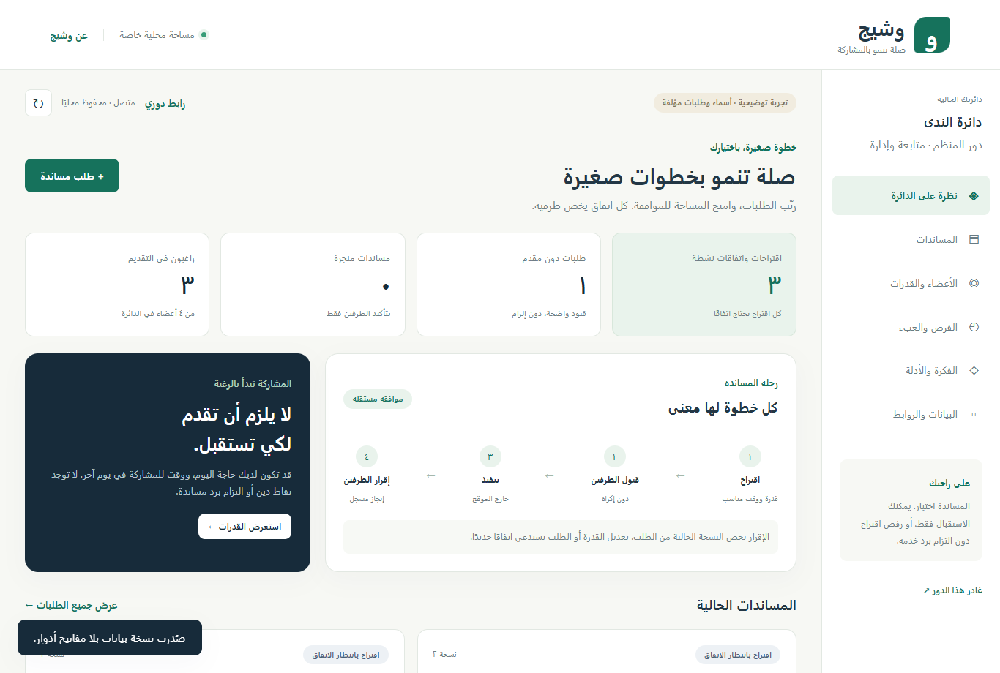
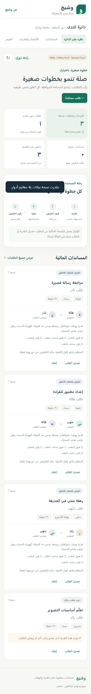

# وشيج

مساندات صغيرة بين معارف بالغين: رغبة وقدرة ووقت وسعة، ثم اقتراح وقبول مستقل وإقرار تنفيذ مستقل للطرفين. موقع عربي RTL يعمل محليًا دون حزم تشغيل خارجية ودون مفتاح ذكاء اصطناعي.

هذا **نموذج أولي خاص**، وليست له رخصة مفتوحة المصدر ممنوحة. جميع أسماء وطلبات دائرة «الندى» مؤلفة. لا توجد بيانات مشاركة شخصية أو نتائج ميدانية أو ادعاء بانخفاض الوحدة. لا تشخيص ولا شبكة غرباء ولا دين خدمة؛ يستطيع العضو استقبال المساندة فقط.

## تشغيل سريع

يتطلب Node.js 22 أو أحدث. في بيئة بها npm وNode على PATH:

```powershell
npm start
npm test
npm run build
npm run verify
```

افتح [وشيج محليًا](http://127.0.0.1:4172). يُربط الخادم بـ127.0.0.1 فقط. لتغيير المنفذ: `$env:PORT=4182; npm start`. لا يوجد تثبيت npm مطلوب؛ `package.json` خاص ولا يحتوي dependencies.

في هذه البيئة استخدمنا Node المرفق، دون الاعتماد على Node النظام:

```powershell
& 'C:\Users\fysl9\.cache\codex-runtimes\codex-primary-runtime\dependencies\node\bin\node.exe' server.mjs
& 'C:\Users\fysl9\.cache\codex-runtimes\codex-primary-runtime\dependencies\node\bin\node.exe' --test test/*.test.mjs
& 'C:\Users\fysl9\.cache\codex-runtimes\codex-primary-runtime\dependencies\node\bin\node.exe' scripts/build.mjs
```

يحفظ الخادم البيانات في `data/circles.json` المتجاهل في Git؛ لا يرسلها إلى خدمة أخرى. ملفات `dist/` بناء قابل للتشغيل بـ`node dist/server.mjs` وبداخله نسخة خاصة مستقلة، لا يشمل البيانات المحلية. لا تفتح index.html مباشرة؛ واجهات الأدوار تتطلب خادم HTTP.

## مشهد عرض كامل

1. افتح البداية واضغط **جرّب دائرة توضيحية**. يظهر تنبيه بأن الشخصيات والطلبات مؤلفة، ومنها طلب تصوير غير مغطى لغياب القدرة.
2. في **المساندات** اختر طلبًا له مقدم. دوّن اسمي المقدم وصاحب الطلب. لا توجد أزرار إقرار في دور المنظم.
3. من **الأعضاء والقدرات** أصدر دعوة لكل طرف. افتح كل دعوة في تبويب مستقل. الدعوة أحادية الاستخدام؛ يختار كل دور سرًا خاصًا من ١٢ حرفًا على الأقل. في العرض يختار المختبِر أسرارًا لشخصيات مؤلفة، وليس لمشاركين حقيقيين.
4. من دور المقدم اقبل الاقتراح. من دور صاحب الطلب اقبله أيضًا. يظل مجرد قبول واحد غير كافٍ لبدء التنفيذ المتفق عليه.
5. التنفيذ الفعلي خارج الموقع. في العرض يمكنك محاكاته صراحةً: أقر التنفيذ من دور المقدم. تبقى الحالة بانتظار الطرف الآخر. أقرّه من دور صاحب الطلب؛ عندها فقط تصبح **منجز بإقرار الطرفين**.
6. عد إلى المنظم وحدّث الصفحة. راجع **الفرص والعبء**، ثم صدّر JSON من **البيانات والروابط**. النسخة لا تشمل مفاتيح أو قيم مشتقة للأسرار.
7. جرّب تغيير مدة طلب أو قدرة عضو: يُنشأ رقم نسخة جديد وتُلغى موافقات النسخة المتغيرة. الرفض يعيد التخطيط ويستبعد المقدم الرافض لهذا الطلب. سحب صاحب الطلب يلغي الطلب.

للرحلة الفارغة: **أنشئ دائرتك** ← أضف أسماء مستعارة ورغبات صريحة ← أضف طلبًا ← أصدر الدعوات ← اتفق الطرفان وأقرّا. الحد **٦ أعضاء و٦ طلبات للجولة**. كان الموجز يسمح بثمانية؛ خُفض الحد بموافقة المراجعة لتحديد كلفة التعداد الكامل واستجابة النموذج المحلي. لا حذف لطلب مغلق لإعادة استخدام حصته؛ أنشئ دائرة جديدة لجولة جديدة.

## التوزيع القابل للفحص

كل طلب له صاحب وقدرة ومدة ونافذة وقت. المرشح يجب أن يكون راغبًا صراحة، غير صاحب الطلب، يملك القدرة والنافذة، ولم يرفض الطلب، وله سعة تكفي. المدة ١٥–١٢٠ دقيقة بمضاعفات ١٥، والسعة ٠–٢٤٠ دقيقة لكل الجولة. النوافذ «صباح، ظهر، مساء، نهاية الأسبوع» ليست تقويمًا دقيقًا؛ تحديد الموعد مسؤولية الطرفين.

يعدد المحرك كل حلول النطاق المحدود مع فرع «دون تخصيص». يختار هدفًا معجميًا:

1. أكبر عدد من الطلبات غير المحجوزة المغطاة.
2. أقل مجموع `Σ(load_i / capacity_i)^2`، حيث load يشمل المقبول والمنجز والمقترح في الجولة والسعات هي الأصلية.
3. أقل `Σ(previousOpportunities_i + acceptedPendingCount_i + newCount_i)^2` على الراغبين. الإنجاز يزيد الفرص السابقة مرة واحدة، فلا يدخل مرة ثانية كطلب مقبول.
4. ترتيب معرّفات مقدمين ثابت، حسب ترتيب معرّفات الطلبات، مع وضع عدم التخصيص أخيرًا. تستخدم مقارنة العبء هامشًا عدديًا `1e-10` لتساوي الكسور المحسوبة بـNumber.

بعد قبول أحد الطرفين يُحجز المقدم وتُحجز سعة الطلب؛ إعادة التخطيط لا تنقله تلقائيًا. تعديل طلب/قدرة مرتبط به يُبطل قبولاته ويسمح باقتراح جديد. لا يغيّر التعديل سجل إنجاز مغلق. يشرح الطلب غير المغطى أول قيد فعلي حاسم: رغبة/رفض، قدرة، نافذة، سعة أصلية، سعة محجوزة، أو سعة متنافسة في الجولة.

هذا حل أمثل للهدف العددي المعلن ضمن النطاق فقط؛ لا يثبت «أفضل علاقة» ولا عدالة اجتماعية شاملة. لا يستخدم المحرك الذكاء الاصطناعي أو نشاط المستخدم لاستنتاج الرغبة. يعرض الموقع مقارنة مباشرة مع baseline أول عضو مؤهل حسب المعرّف، دون رجوع، وبالقيود والسعات المحجوزة نفسها. لا تُعرض نسب تحسن ثابتة من عينة العرض.

## الأدوار والبيانات

- المنظم ينشئ الدائرة والأعضاء والطلبات، ويصدر **دعوة** غير قادرة على الإقرار أو قراءة الدائرة. الدعوة تُستهلك لتسجيل عضو بسر خاص؛ الاستجابة لهذا التسجيل وحدها تحتوي credential العضو. لا يستطيع المنظم إعادة الدعوة لعضو مسجل أو استعادة سره.
- لا يثبت النظام هوية أول إنسان يفتح الدعوة. إذا فتحها المنظم قبل صاحبها فقد يسجل ذلك الدور؛ لذلك لا ندعي منع انتحال الهوية البشرية بالكامل. بعد التسجيل الصحيح لا تُصدر صلاحية العضو من endpoint المنظم.
- يحفظ الخادم token hash من SHA-256، والسر بقيمة مشتقة بـscrypt وsalt عشوائي. يعرض العضو الطلبات التي يشارك فيها فقط، ويرى أسماء وقدرات أعضاء الدائرة. قوائم grants وenrollments لا تدخل أي view أو export.
- جميع مفاتيح الأدوار والدعوات لها مدة ثابتة **٧ أيام** من إصدارها. يبدأ عمر دور العضو عند التسجيل؛ الرجوع بالسر لا يمدد عمره. بعد انتهاء الدور لا توجد آلية admin-reset في هذا النموذج؛ يلزم إنشاء دائرة جديدة. حد التخزين ٢٠ دائرة محلية.
- رابط الدور يستخدم fragment في المتصفح، ثم تُزال القيمة من العنوان وتُحفظ في sessionStorage لذلك التبويب. أزرار فتح الأدوار تستخدم تبويبات مستقلة وnoopener. المغادرة تمسح جلسة التبويب فقط. صفحة الدور تعرض رابط العودة بالسر الخاص للعضو إن فقد رابط credential.
- كل كتابة تتطلب Origin مطابقًا، JSON محدودًا بـ٢٤ كيلوبايت، مضيف localhost/127.0.0.1 على المنفذ نفسه، وحقولًا مسموحة ومتحققًا منها. النص يضاف عبر textContent، ولا يوجد innerHTML أو eval أو سجل tokens/طلبات. CSP يمنع السكربتات الخارجية والإطارات.
- التخزين متسلسل، يكتب نسخة مؤقتة ثم rename؛ لا تُنشر النسخة في الذاكرة ولا يُرد نجاح قبل الحفظ. فشل القرص يعيد HTTP 500. الخادم عملية واحدة؛ لا يصلح تشغيل عمليتين على الملف نفسه.
- التصدير يخص المنظم. المسح يتطلب كتابة اسم الدائرة ويحذف سجلها ويُبطل كل روابطها. لا يمسح نسخة سبق تنزيلها. الملف غير مشفر؛ حماية الجهاز والقرص مسؤولية المشغل.

## الاختبارات والأدلة

`test/core.test.mjs` يحتوي مرجعًا مستقلاً يعد Cartesian product ويتحقق من الحل كاملًا، على ٤٠ حالة صغيرة. اختبارات إضافية للقيود والحسم الثابت والرفض وتغيير النسخ والإقرارين والدعوة الأحادية والانتهاء. حالة المراجعة: سعتان ١٠٠/٥٠، طلب ٥٠ محجوز للأول وطلب ١٠ جديد؛ يختار الثاني ليصبح العبء ٠٫٢٩ بدل ٠٫٣٦.

`test/http.test.mjs` ينفذ رحلة HTTP كاملة على منفذ محلي مؤقت: دعوة وتسجيل، صلاحيات مستقلة، منع منظم/عضو ثالث، قبول وإقرار، تعديل stale، تصدير بلا أسرار، إعادة تحميل ملف، نص خبيث كنص، حذف، وفشل حفظ مُحاكى. تستخدم الاختبارات مجلدًا مؤقتًا مستقلًا وتزيله بعد كل اختبار.

التعداد الكثيف عند الحد ٦×٦ اختُبر فعليًا. البناء يفحص syntax لكل الوحدات، وجود RTL، وغياب منافذ DOM غير الآمنة، ويجمع dist مع manifest hashes. أدلة التشغيل الفعلية في [تقرير التنفيذ](docs/implementation-report.md) و[evidence.json](docs/evidence.json)، والمخططات في [المعمارية](docs/architecture.md).

صور الواجهة الحقيقية يضيفها المنسق بعد تشغيل الرحلات في المتصفح؛ مخططات SVG هنا مخططات تفسيرية وليست لقطات واجهة.

## البدائل وحدود الفكرة

يوفر [Lotsa Helping Hands: How It Works](https://lotsahelpinghands.com/how-it-works) تقويم طلبات مساندة، مثل الوجبات والزيارات والتنقل. تصف [TimeBanks.Org: How It Works](https://www.timebanks.org/how-it-works) تبادل خدمات برصيد وقت: ساعة تقديم تقابل رصيد ساعة. اطلعنا على هذين المصدرين الرسميين في ٨ أكتوبر ٢٠٢٦؛ لا ندعي اختراع التطوع ولا مقارنة شاملة بكل ميزاتهما.

الفرق المقترح في وشيج هو هدف توزيع معلن يجمع التغطية والعبء والفرص، داخل دائرة صغيرة، مع إقرار مستقل للطرفين على نسخة محددة، دون رصيد دين خدمة. قد تكون Sheets أو ورقة مشتركة أو مجموعة تنسيق كافية عندما تكون الطلبات قليلة. اختيار البرنامج بدلها فرضية تحتاج اختبار سهولة استخدام لاحقًا.

قبل نشر خارجي يلزم TLS وتسجيل دخول وتحقيق هوية، إدارة مدة الجلسات واستعادة الحسابات، تدقيق مستقل، دعم التقويم والإنذارات، وسياسة بيانات وموافقة بشرية. لا يرسل هذا النموذج بريدًا أو رسائل ولا ينفذ مساندة خارجية ولا يقيّم الحالة النفسية. يمكن دراسة الانتماء لاحقًا بموافقة مشاركين ومنهج مستقل؛ نتائج العدّ الآلي وحدها لا تكفي.

## بنية الملفات

```text
server.mjs                 HTTP، Origin، صلاحيات، ملفات ثابتة
src/allocator.mjs          تعداد التوزيعات والهدف وbaseline
src/domain.mjs             الدعوة/التسجيل، نسخ الطلب، الموافقة والإقرار
src/store.mjs              حفظ متسلسل ومعاملة لا تنشر قبل الحفظ
src/validation.mjs         حدود الحقول والقيم
src/demo.mjs               أسماء وطلبات مؤلفة
public/                    واجهة عربية HTML/CSS وJavaScript Modules
test/                      اختبارات محرك وHTTP وحفظ
scripts/build.mjs          فحص وتجميع مستقل دون حزم
docs/                      أدلة ومخططات وتقرير تنفيذ
data/                      بيانات محلية متجاهلة في Git
```

## صور النسخة المنفذة والتحقق النهائي





تحقق المنسق من 10 اختبارًا ناجحًا دون احتساب نسخ dist، ومن رحلة المتصفح والتصدير والعرض بعرض 390px دون أخطاء JavaScript أو تجاوز أفقي. الأدلة في `docs/coordinator-final-tests.txt` و`docs/coordinator-browser-qa.json`. حالات التجربة مؤلفة ولا تمثل أثرًا اجتماعيًا مقاسًا.
