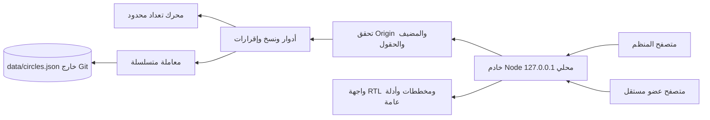
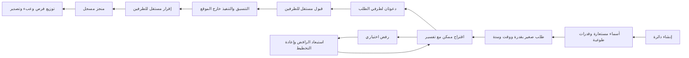
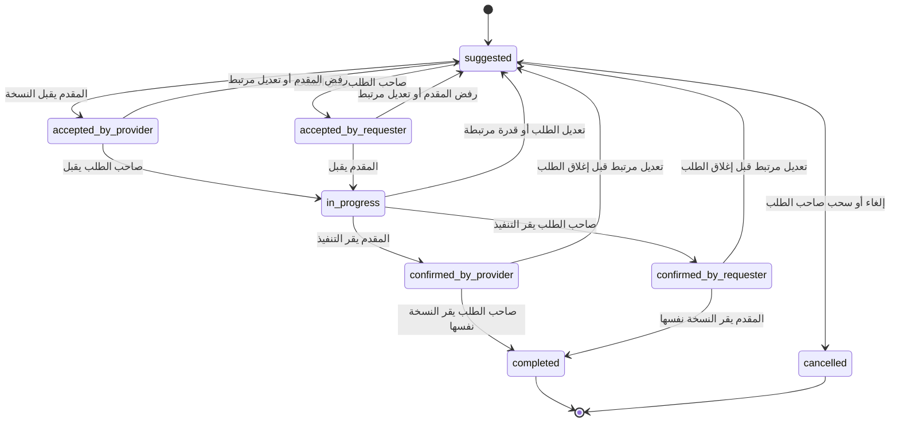
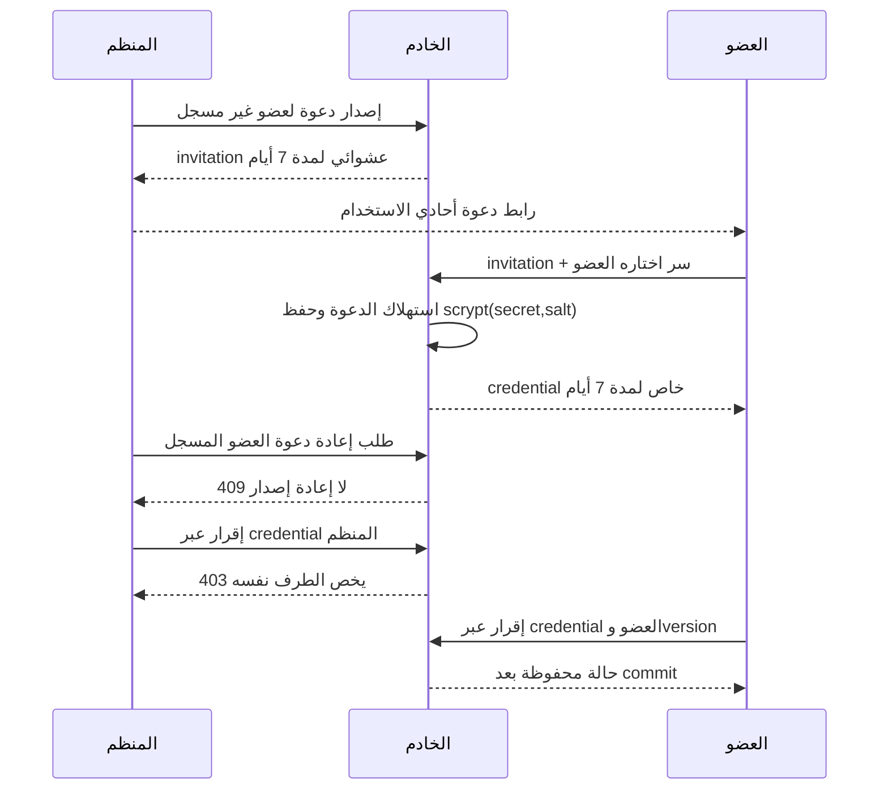
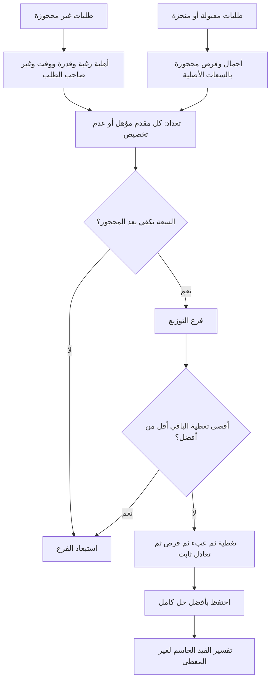
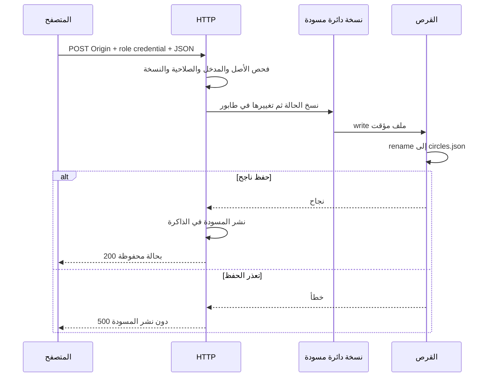
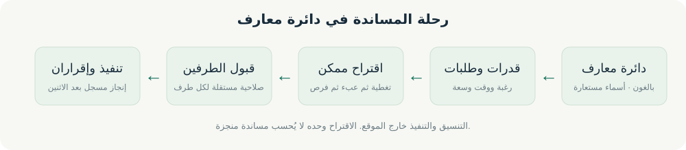
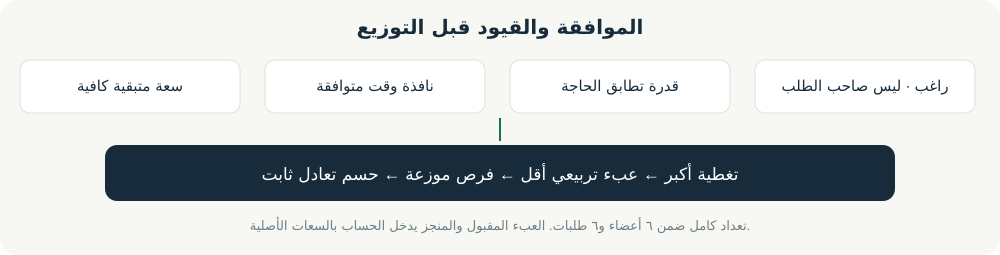

# معمارية وشيج

المخططات الستة الآتية وصف للمنفذ فعليًا. حد النطاق ٦ أعضاء و٦ طلبات؛ كل دائرة مخزنة محليًا، ولا اتصالات تشغيل بخدمة AI.

## ١. حدود النظام

## ٢. الرحلة

## ٣. حالات الطلب

يسمح التعديل بإبطال إقرار واحد قبل إغلاق الطلب؛ يُرفع version ولا تقبل إجراءات النسخة السابقة. الطلب المغلق غير قابل للتعديل. الرفض لا يسمح به بعد إقرار تنفيذ أحد الطرفين؛ التعديل الصريح متاح قبل الإنجاز.

## ٤. دعوة وتسجيل خاص

لا يثبت هذا البروتوكول من فتح الدعوة أولًا؛ لا ندعي منع انتحال الهوية البشرية. يؤمّن فصل إصدار الصلاحية بعد تسجيل العضو بسر خاص، ولا يملك المنظم endpoint إعادة ضبط ذلك السر.

## ٥. البحث وهدفه

مع `m` أعضاء و`r` طلبات يحدّ التعداد `(m+1)^r` قبل تقليم القيود. في طلب صحيح صاحبُه ضمن الدائرة، فيقل عدد المرشحين إلى `m-1` ويكون الحد `m^r` شاملاً عدم التخصيص، أي `6^6 = 46,656` فرع ورقة خام؛ التقليم يخفض visited الفعلي. لا يُستبعد فرع ممكن بسبب العبء؛ التقليم الوحيد للقيمة يمنع فرعًا لا يمكنه بلوغ أفضل تغطية. لذلك كل حل مفضل ممكن بقي قابلًا للفحص. الذاكرة عمق r وأفضل صفوف، دون cache تزداد مع كل حل. مقارنة كسور JavaScript لها هامش عددي معلن.

## ٦. الحفظ والتحقق

ملف القرص لا يشفر الأسماء/الطلبات، ولا يدعم عمليتين متزامنتين. الحذف يكتب ملف الدوائر المتبقية، فلا تبقى الدائرة في ملف البيانات الحالي. قد يبقى ملف مؤقت عند تعطل العملية أثناء الحفظ؛ تُعامل مجلدات data والنسخ الاحتياطية كلها كبيانات خاصة.

## SVG قابلة للعرض

الرسوم تفسيرية مؤلفة. اللقطات الحقيقية تُضاف بعد تحقق المتصفح.
